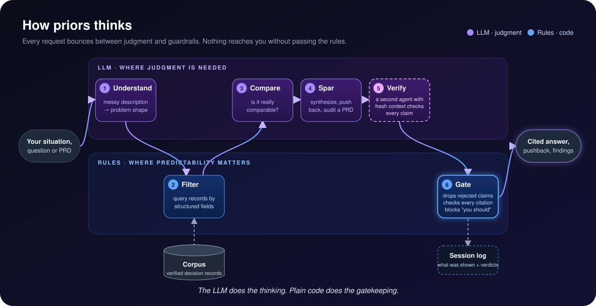
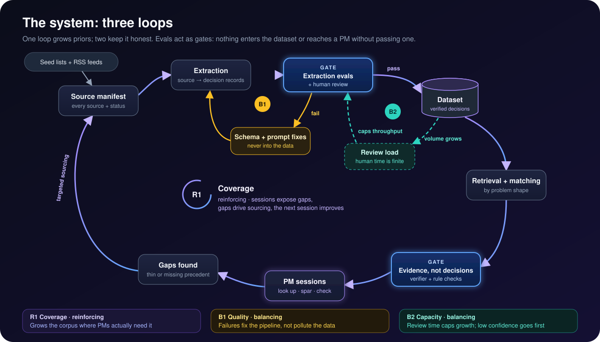

# Priors

**A room full of product precedent. You run the meeting.**

*A sparring partner for product decisions, backed by precedent from the best product teams.*

`priors` is a sparring partner for product managers, backed by a structured, sourced dataset of product decisions that big tech companies have published. Whenever you're working through a product decision (exploring it, arguing it, writing it up), you can ask priors how comparable teams handled the same problem: how they framed it, which alternatives they weighed, what they gave up and what failed. It brings that evidence into the conversation and pushes back on your thinking. The PRD is one place that thinking ends up, not the product itself.

It's like working alongside product teams from across big tech without them being in the same room, with one honest caveat: what's in the room is their *published* decisions, not the people. They can't answer follow-up questions, and companies mostly publish what worked. priors says so whenever the evidence is thin.

> **Design principle: evidence, not decisions.** priors never tells you what to do. It shows what comparable companies did, what they optimized for, what they gave up and where the evidence is thin. You think; you decide.

The name comes from statistics: a *prior* is what you know before you decide.

## Why this exists

I collected a corpus of real product decisions published by big tech companies: engineering blogs, papers and talks on how teams at Netflix, Uber, Airbnb, Spotify and others decided what to build. Reading it, I kept noticing the same thing: **this is exactly the knowledge a PM needs at the moment of a hard decision, and it's almost unusable at that moment.** It's scattered across hundreds of posts, written for engineers, and finding the part that matters to *your* problem takes hours. So most PMs skip it and decide on instinct, or ask a general AI assistant that gives confident, unsourced answers.

### The user story

> *As a PM facing a product decision I haven't made before, I want to spar with how comparable teams handled the same problem (what they tried, what it cost them, what failed) so that I can make and defend a better decision before my team commits time to it.*

- **Primary user:** a PM at a growing company facing something new to them: a first pricing change, a first recommendation feed, a first marketplace incentive.
- **Stakeholders:** the engineering lead and leadership who review the plan, the people who ask "has anyone done this before? what could go wrong?"
- **Cost today (hypothesis, measured in the study):** hours of scattered research per PRD, or skipped research that resurfaces later as rework.

### The research question

**Does sparring with real product precedent help PMs think through decisions, or is it just interesting reading?**

priors is a proof of concept built to answer that question: the smallest queryable system that turns the corpus into structured decisions a PM can think with. It's being tested in a recorded user study with PMs, run in rounds, with the system improved between rounds based on what the sessions show. See the [study protocol](docs/study/).

## Status

🧪 **Proof of concept + user study.** The schema is defined and the corpus is collected. Next: hand-structure 10–15 decisions in a first focus area (personalization and experimentation), run them through a prototype, and test with PMs before investing in automated extraction or scale. Progress and reasoning are tracked in the open: see the [roadmap](ROADMAP.md) and the [decision log](docs/decisions/).

## How it works

Reference libraries in other fields are mostly used to *look things up and think*, not to generate deliverables. When Mobbin analyzed over 300,000 real queries to its design library, none of the top 50 asked it to generate anything; people looked things up mid-work. Architects use precedent in almost every phase of design, not just one document. priors is built around the same behavior, in four modes:

| Mode | The PM's question | When |
| --- | --- | --- |
| **Look up** | "How did Airbnb handle cold start?" | Mid-work, in seconds |
| **Spar** | "Here's my plan. Push back." | Before committing to a direction |
| **Persuade** | "Who else has done this, and what happened?" | Preparing for a review or stakeholder conversation |
| **Check** | "What am I missing in this PRD?" | Before a document goes out |

The first three happen in one conversation (`priors think`); the fourth is a focused verb (`priors audit prd.md`). A sparring session runs like this:

1. **Intake:** a few questions about the product, users, company stage and constraints.
2. **Match:** analogous decisions found by the *shape* of the problem (e.g. two-sided, supply-constrained, local), not just by industry.
3. **Spar:** how comparable teams framed similar problems, the alternatives they considered, what they traded off and what failed, all cited. priors pushes back with questions and counter-examples; you decide what to carry forward.
4. **Brief:** a short, cited summary of what you concluded and why, ready to take into a PRD, a review or a conversation.

**Every claim is verified before you see it.** A separate verifier agent, with fresh context, checks each precedent claim: does the source actually say this, is the situation genuinely comparable, and is there counter-evidence? Claims are marked *confirmed* or *needs check*; anything rejected is never shown. See [docs/poc-design.md](docs/poc-design.md).

## Architecture: rules vs. LLM

priors uses plain, predictable code wherever it can, and an LLM only where the task needs judgment. Each step below is marked as one or the other.

<p align="center"></p>

| Step | Type | Why this type |
| --- | --- | --- |
| Understand the situation | LLM | PMs describe their problem in messy, free-form language ("early-stage app for local tutors, thin supply, leadership wants growth"). Turning that into a problem shape (two-sided, supply-constrained, local) needs language understanding. |
| Filter candidate records | Rules | Once the shape is known, narrowing records by structured fields is a plain query. It's cheaper, faster and fully predictable. |
| Judge comparability | LLM | No record will match a new problem exactly. Deciding that a food-delivery cold-start problem is *relevant* to a tutoring marketplace, and how it differs, is reasoning by analogy. |
| Spar, synthesize or audit | LLM | Combining several decisions into one picture, pushing back on *this* PM's plan, and reading a free-form PRD for gaps can't be scripted. |
| Verifier | LLM | Checking whether a claim is truly supported, comparable and uncontested means reading the record and the claim with judgment. It runs as a *separate* agent with fresh context, so it doesn't inherit the first agent's assumptions. |
| Gate and checks | Rules | The final safeguards are deterministic: rejected claims are removed, every claim must cite a record that actually exists, prescriptive phrasing is flagged, and labels are applied. Rules here can't be talked out of. |
| Session log | Rules | Recording what was shown and the verdicts is bookkeeping, and it supplies the study's system-quality measures. |
| Corpus | Data | Hand-structured and checked against sources before it's ever used (see [The dataset](#the-dataset)). |

**Why use an LLM at all?** If PMs only needed to filter decisions ("show me pricing decisions in two-sided marketplaces"), a searchable list would be enough, and priors would be a website. The LLM earns its place in four jobs rules can't do: understanding a messy description, reasoning by analogy, synthesizing across decisions, and sparring with a specific plan. The study tests this directly: if PMs get as much value from a plain filterable list as from the conversation, the LLM isn't justified.

## The dataset

Product case studies from engineering blogs, papers, talks and podcasts. Not every case study is about a decision, so each source is first [triaged](docs/source-triage.md): only sources with a real choice, a reason and a consequence become precedent. Engineering write-ups and frameworks are kept as supporting context, never cited as precedent. Decision sources are structured into two linked record types:

- **Source records:** one per article, paper or talk (identity, type, whether it's a company self-report or independent).
- **Decision records:** one per distinct product decision inside a source (problem, objective and guardrail metrics, the key tradeoff, results, what failed, ethics considerations, lineage), every field linked to the evidence it came from.

Each decision is classified into one primary bucket (and up to two secondary ones):

| Bucket | Covers |
| --- | --- |
| Personalization & Recommendations | Feeds, homepages, "for you" surfaces, user modeling |
| Search & Discovery | Query understanding, search ranking, browse and navigation |
| Pricing & Monetization | Dynamic pricing, plans and tiers, discounts, paywalls |
| Ads | Ad ranking, auctions, advertiser tools, ad load |
| Marketplace Design | Matching, supply/demand balance, two-sided incentives |
| Growth & Acquisition | Funnels, referrals, viral loops, onboarding conversion |
| Engagement & Retention | Notifications, habit loops, churn reduction |
| Experimentation & Metrics | A/B platforms, metric design, guardrails, causal inference |
| Trust, Safety & Integrity | Protecting users from bad actors: fraud, spam, moderation |
| Responsible AI, Ethics & Governance | Effects of a company's own systems: fairness, privacy, transparency, wellbeing, compliance |
| UX & Product Design | Interface changes, information architecture, accessibility |
| AI & LLM Features | Assistants, generative features, evals, agentic workflows |
| Platform & Infrastructure Decisions | Build vs. buy, migrations, consolidation, tech debt |

Every bucket adds its own fields on top of the core schema (e.g. `signal_freshness` for personalization, `elasticity_tested` for pricing). Full field definitions: [docs/schema.md](docs/schema.md).

## The system

priors is three interacting loops, not a pipeline. Evals act as gates: nothing enters the dataset or reaches a user without passing one.

<p align="center"></p>

| Loop | Type | How it works | Main risk |
| --- | --- | --- | --- |
| **R1: Coverage** | Reinforcing | Sessions expose questions with thin precedent; those gaps drive targeted sourcing, which makes the next session better. | Chasing gaps the dataset can't credibly fill |
| **B1: Quality** | Balancing | Failed extraction evals route back to schema and prompt fixes, not into the dataset. Accuracy is held above target instead of drifting as volume grows. | Fixes overfit to the pilot set |
| **B2: Capacity** | Balancing | More data means more review load, which caps how fast sources can be admitted. | Growth stalls, or review gets skipped. Mitigated with confidence-based sampling: low-confidence records get human review first. |

What gets measured at each gate: field-level extraction accuracy, retrieval relevance for matched precedents, and an LLM-judge rubric scoring whether the assistant cites evidence without prescribing decisions.

## Repository layout

```
docs/
  decisions/   one file per major decision (options, reasoning, revisit triggers)
  schema.md    category buckets, core fields, category-specific fields
  prd/         priors' own PRD, co-written using priors
  source-triage.md how sources are scored and assigned a role
  poc-design.md how the proof of concept works (modes, verbs, verifier)
  study/       user study protocol, interview guide, consent form, findings per round
schema/        JSON Schemas for source and decision records
pipeline/      collect → fetch → classify → extract → link
evals/         extraction, retrieval, and "evidence, not decisions" evals
data/
  manifest.csv every source and its pipeline status
  raw/         private source texts (git-ignored, never published)
app/           explorer and co-writer (later)
```

## Related work

Good collections of case studies already exist, and priors builds on what they've shown. The difference is what you can do with them: existing tools help you **find articles about** product decisions; priors lets you **reason across the decisions themselves**.

| Project | What it is | How priors differs |
| --- | --- | --- |
| [Product Case Studies](https://github.com/aaronbatchelder/product-management-case-studies) | Open-source library of ~250 PM case studies in 19 categories, with an MCP server for keyword search | One record per article (title, link, tags, summary) vs. structured decision records with metrics, results, tradeoffs and evidence pointers |
| [Evidently AI ML system design](https://www.evidentlyai.com/ml-system-design) | 650+ links to ML and LLM system case studies, filterable by industry and use case | Engineering focus (how systems are built) vs. product focus (what was decided, for whom, and why) |
| [ZenML LLMOps Database](https://huggingface.co/datasets/zenml/llmops-database) | ~2,000 LLM-in-production case studies with LLM-written summaries, on Hugging Face | Same copyright approach (summaries plus links); priors adds a decision-level schema across 13 product categories |
| [eugeneyan/applied-ml](https://github.com/eugeneyan/applied-ml) | Curated list of applied-ML papers and blog posts by topic | Used as a seed list; priors structures what those sources contain |
| AI PRD writers (e.g. ChatPRD) | Generate and critique PRDs from prompts; newer tools ground them in a team's own customer data | priors grounds PRDs in *other companies'* sourced precedent, and never prescribes the decision |
| Expert-archive chatbots (e.g. Lennybot) | Chat over one author's newsletter and podcast | Many companies' decisions, structured and cross-comparable, rather than one person's advice |

**Search vs. query.** Keyword search finds documents that mention your words. priors' structured fields support questions *across* decisions, e.g. "which pricing decisions in two-sided marketplaces tested elasticity, and what did they find?" They also support matching by problem shape (two-sided, supply-constrained, local) rather than by wording.

## Content and copyright

priors is an index, not an archive. It publishes structured metadata, original summaries, extracted facts and links back to every source. It never republishes source text, and paywalled material is excluded. Source texts used for extraction stay private and out of this repository.

priors is an independent project and is not affiliated with, endorsed by or sponsored by any company whose published work it cites. Company names are used only to identify the sources of those publications.

## License

Code: [MIT](LICENSE). Dataset metadata and summaries: CC BY 4.0 (planned for the Hugging Face release). Original sources belong to their authors.
