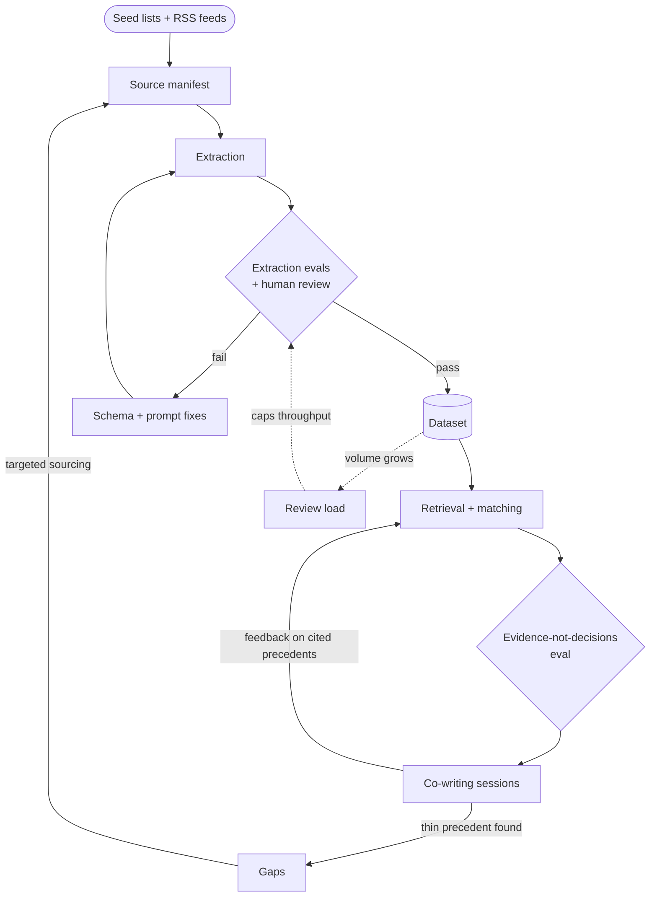

# Priors

**Co-write PRDs grounded in real product decisions.**

`priors` is a PRD co-writing assistant backed by a structured, sourced dataset of product decisions from big tech companies. You describe what you're building, for whom and at what kind of company. It finds analogous decisions, proposes a PRD structure focused on your problem, and challenges each section with cited evidence.

> **Design principle: evidence, not decisions.** priors never tells you what to do. It shows what comparable companies did, what they optimized for, what they gave up and where the evidence is thin. You write; you decide.

The name comes from statistics: a *prior* is what you know before you decide.

## Status

🚧 **Pilot phase.** The schema is defined and a 30-source pilot is being extracted to test it before scaling to 300–500 sources. Progress and reasoning are tracked in the open; see the [decision log](docs/decisions/).

## How it works

A co-writing session has five steps:

1. **Intake:** a short interview about the product, users, company stage and scale, business model, region and constraints.
2. **Match:** analogous decisions found by the *shape* of the problem (e.g. two-sided, supply-constrained, local), not just by industry.
3. **Structure:** core PRD sections plus sections specific to the category, each seeded with questions from where precedents struggled.
4. **Co-write:** you draft; priors offers precedents, counter-examples and missing considerations, all cited.
5. **Review:** a critique of the full draft against precedents, flagging gaps, unsupported assumptions and missing metrics.

## The dataset

Product case studies from engineering blogs, papers, talks and podcasts, structured into two linked record types:

- **Source records:** one per article, paper or talk (identity, type, whether it's a company self-report or independent).
- **Decision records:** one per distinct product decision inside a source (problem, objective and guardrail metrics, the key tradeoff, results, what failed, ethics considerations, lineage), every field linked to the evidence it came from.

Records are classified into 13 category buckets, from Personalization & Recommendations and Pricing & Monetization to Responsible AI, Ethics & Governance and Platform & Infrastructure Decisions. See [docs/schema.md](docs/schema.md).

## The system

priors is three interacting loops, not a pipeline. Evals act as gates: nothing enters the dataset or reaches a user without passing one.



| Loop | Type | How it works | Main risk |
| --- | --- | --- | --- |
| **R1: Coverage** | Reinforcing | Sessions expose questions with thin precedent; those gaps drive targeted sourcing, which makes the next session better. | Chasing gaps the dataset can't credibly fill |
| **B1: Quality** | Balancing | Failed extraction evals route back to schema and prompt fixes, not into the dataset. Accuracy is held above target instead of drifting as volume grows. | Fixes overfit to the pilot set |
| **B2: Capacity** | Balancing | More data means more review load, which caps how fast sources can be admitted. | Growth stalls, or review gets skipped. Mitigated with confidence-based sampling: low-confidence records get human review first. |

What gets measured at each gate: field-level extraction accuracy, retrieval relevance for matched precedents, and an LLM-judge rubric scoring whether the assistant cites evidence without prescribing decisions.

## Repository layout

```
docs/
  decisions/   one file per major decision (options, reasoning, revisit triggers)
  schema.md    category buckets, core fields, category-specific fields
  prd/         priors' own PRD, co-written using priors
schema/        JSON Schemas for source and decision records
pipeline/      collect → fetch → classify → extract → link
evals/         extraction, retrieval, and "evidence, not decisions" evals
data/
  manifest.csv every source and its pipeline status
  raw/         private source texts (git-ignored, never published)
app/           explorer and co-writer (later)
```

## Content and copyright

priors is an index, not an archive. It publishes structured metadata, original summaries, extracted facts and links back to every source. It never republishes source text, and paywalled material is excluded. Source texts used for extraction stay private and out of this repository.

## License

Code: [MIT](LICENSE). Dataset metadata and summaries: CC BY 4.0 (planned for the Hugging Face release). Original sources belong to their authors.
